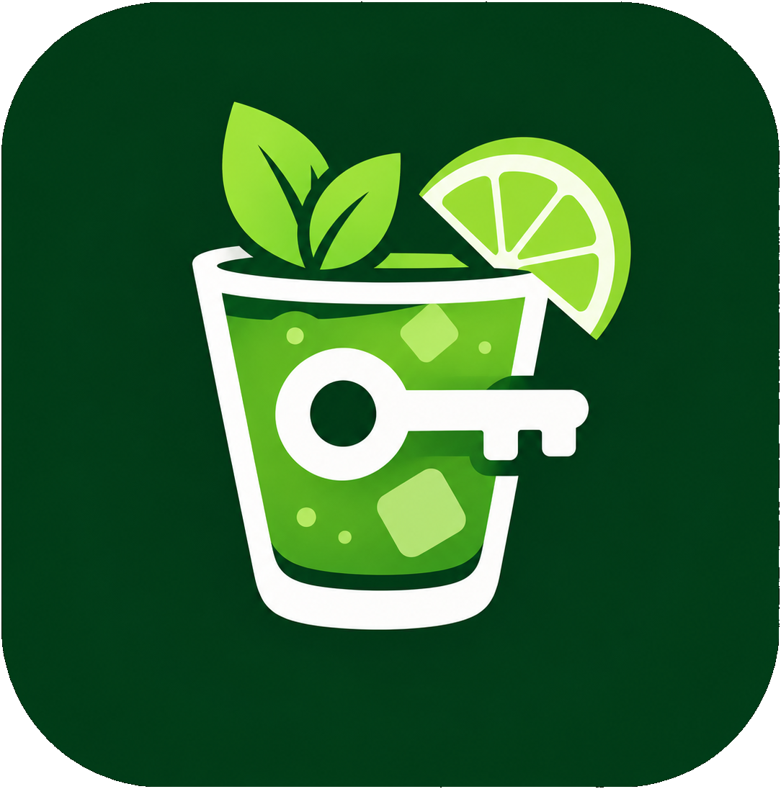

# Mojito

*A Desktop Manager*



> **DISCLAIMER**
>
> - This product is in no way associated with LimeLM or wyDay. Those are registered trademarks in several countries.
> - This product was extruded in-whole or in-part using "ai" / language models.
> - This product violates the security practices listed here: https://wyday.com/limelm/help/account-security/
> - This product will fail if it's used across more than one IP address and may cause the user to be locked out of their account.
> - This product may violate the wyDay Terms of Service (and cause a user to be locked out of their account) if more than one person uses a web API key. https://wyday.com/limelm/terms/

A portable Qt application for creating and reviewing license keys using the
Web API.

## Features

- Create product keys for any product version
- Browse the products and versions of your account
- Browse, search and page through registrations (existing product keys)
- Copy generated keys to the clipboard or save them to a text file
- Fully resizable, single-window UI with tabs
- Portable ZIP package via CPack - no Qt or Visual C++ runtime installation
  required
- Settings stored in `Mojito.ini` next to the executable

## Prerequisites

- Qt 6.11.2 for MSVC 2022 (64-bit), installed at `C:\Qt\6.11.2\msvc2022_64`
- Visual Studio 2022 (C++ desktop workload)
- CMake (in `PATH`, or bundled with Visual Studio)

## WebAPI Setup

This application uses a Web API. The API client code (`include/webapi.h`,
`src/webapi.cpp`) is provided in the repository, but you need to obtain the full
WebAPI PHP implementation and copy it to the `WebAPI/PHP/` directory.

1. Log in to your account at the service provider's dashboard
2. Go to **Settings → API key** and note your API key
3. Download the WebAPI PHP from the service provider's downloads page
4. Extract the PHP files and copy them to `WebAPI/PHP/` directory in this project
5. The application requires the API client file which contains the `PostRequest()`
   and `SetAPIKey()` functions used by the C++ WebAPI client

Without the WebAPI PHP files, the application will not be able to generate or
lookup license keys via the API.

## Building

Run `build.bat` from the project directory:

```bat
build.bat
```

The script configures CMake (Visual Studio 17 2022, x64) and builds the
`Release` configuration. After the build, `windeployqt` automatically copies the
required Qt6 DLLs and plugins next to the executable, so
`build\Release\Mojito.exe` can be started directly.

Manual equivalent:

```bat
mkdir build && cd build
cmake .. -G "Visual Studio 17 2022" -A x64
cmake --build . --config Release --parallel
```

## Creating the portable package

Run `deploy.bat`:

```bat
deploy.bat
```

It rebuilds `Release`, runs CPack and writes:

- `build\package\Mojito_windows.zip` (+ `.sha256` checksum)
- a copy at `Mojito_windows.zip` in the project root

The ZIP is self-contained and portable:

```
Mojito_windows\
    Mojito.exe
    Qt6Core.dll, Qt6Gui.dll, Qt6Widgets.dll, Qt6Network.dll, Qt6Svg.dll
    msvcp140*.dll, vcruntime140*.dll, concrt140.dll   (MSVC runtime)
    qt.conf
    plugins\
        platforms\qwindows.dll
        imageformats\, iconengines\, styles\, tls\, networkinformation\
    README.md, USER_GUIDE.md, LICENSE.txt
```

Extract it anywhere and start `Mojito.exe` - Qt6 and the MSVC runtime
are bundled, so nothing has to be installed (Windows 10 or newer).

Manual equivalent (from the `build` directory):

```bat
cpack -G ZIP -C Release
```

## Usage

1. Paste your API key into the connection area. The application loads
   your products and versions automatically.
2. Select a product and a version.
3. Open the **Generate keys** tab, enter the customer email (optional), the
   number of keys and the number of activations per key, then click
   **Generate keys**.
4. Use the **Registrations** tab to search existing keys by email, and the
   **Products** tab to browse all products and versions.

See [USER_GUIDE.md](USER_GUIDE.md) for the complete user documentation,
including keyboard shortcuts, the settings file and troubleshooting.

## Project layout

| Path | Contents |
| --- | --- |
| `include/webapi.h`, `src/webapi.cpp` | Web API client (products, registrations, key generation) |
| `include/mainwindow.h`, `src/mainwindow.cpp` | Main window and tabs |
| `src/main.cpp` | Application entry point |
| `CMakeLists.txt` | Build, Qt deployment and CPack configuration |
| `build.bat`, `deploy.bat` | Build and packaging scripts |
